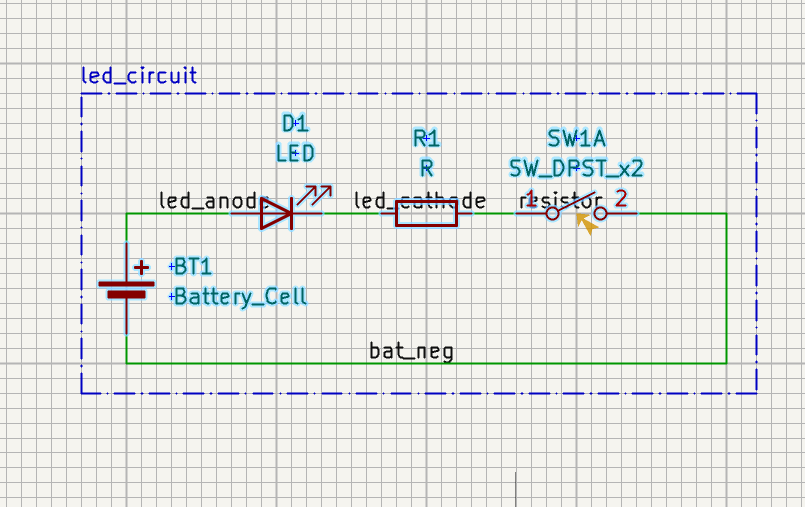
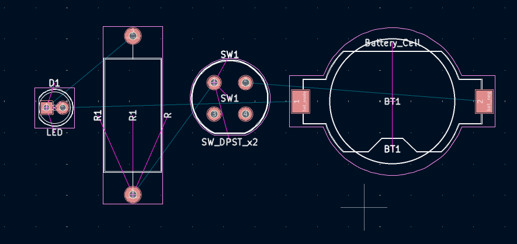
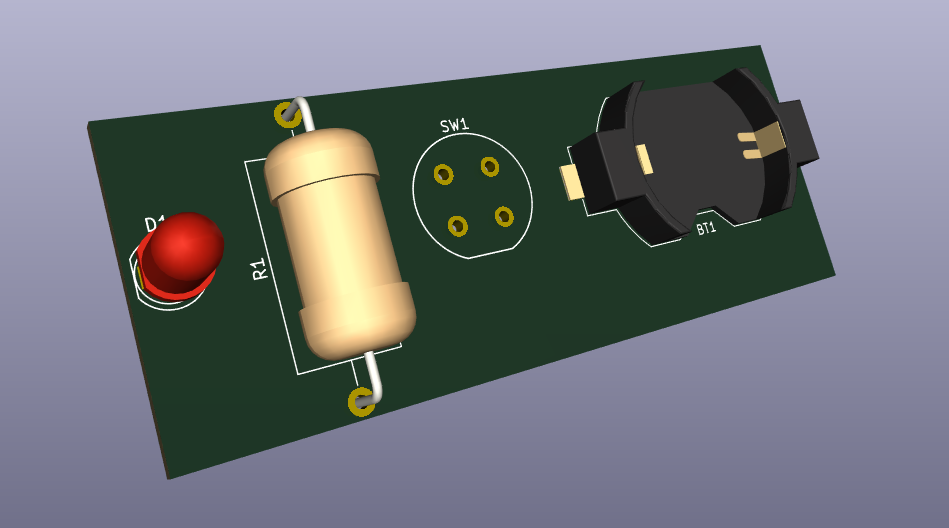
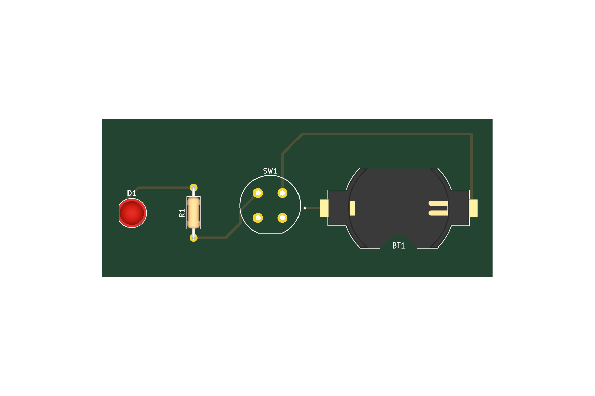
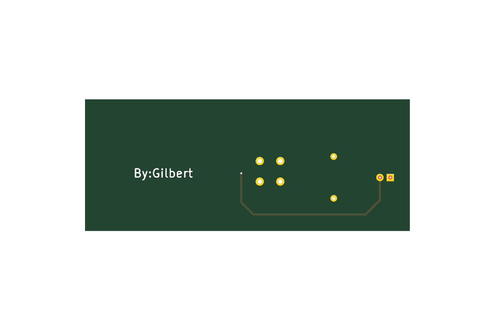
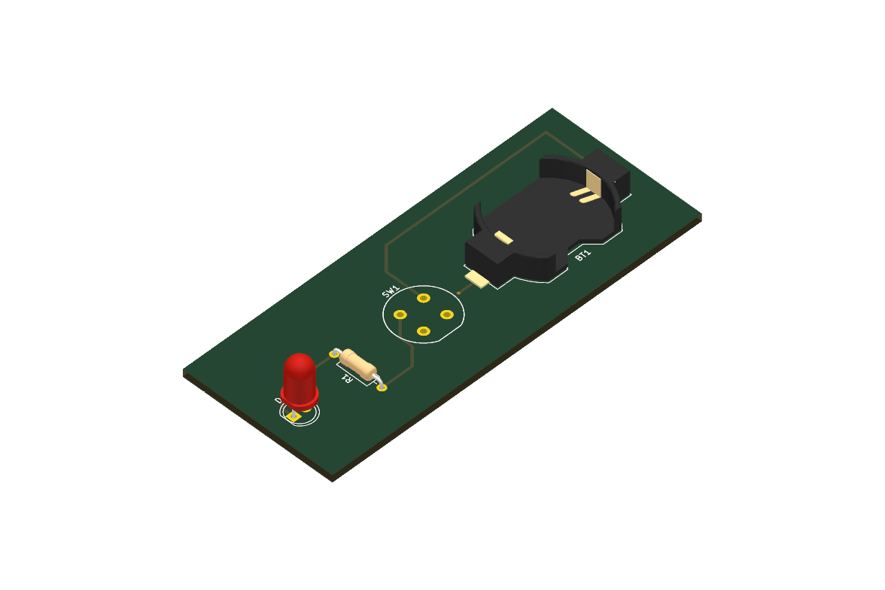

# Práctica #8: Introducción al flujo de trabajo de PCB de KiCAD

**Fecha:** 24/10/2026
**Estudiante:** Gildardo Estevan Restrepo Duque
**Guía:** Introducción al flujo de trabajo de PCB de KiCAD — Prof. Fabio Guzmán, UPB

---

## Objetivo

Recorrer el flujo completo de KiCad 10 —esquemático, verificación eléctrica, footprints, PCB, verificación de diseño y exportación— con un circuito mínimo: una pila de botón que enciende un LED a través de una resistencia y un interruptor.

## Circuito

| Ref | Componente | Footprint |
|---|---|---|
| BT1 | Pila CR2032 | `Battery:BatteryHolder_Keystone_1058_1x2032` |
| D1 | LED 5 mm | `LED_THT:LED_D5.0mm` |
| R1 | Resistencia 1/4 W | `Resistor_THT:R_Axial_DIN0207_L6.3mm_D2.5mm_P10.16mm_Horizontal` |
| SW1 | Pulsador DPST (se usa la unidad A) | `Button_Switch_THT:Push_E-Switch_KS01Q01` |

Redes: `led_anode` (BT1 + → ánodo), `led_cathode` (cátodo → R1), `resistor` (R1 → SW1), `bat_neg` (SW1 → BT1 −).

## Archivos de esta práctica

- Proyecto KiCad: [`08_kicad_flow_work/led_circuit_v1`](../08_kicad_flow_work/led_circuit_v1)
- Esquemático en PDF: [`out/led_circuit_v1.pdf`](../08_kicad_flow_work/led_circuit_v1/out/led_circuit_v1.pdf)
- Reportes: [`out/erc.rpt`](../08_kicad_flow_work/led_circuit_v1/out/erc.rpt) · [`out/drc.rpt`](../08_kicad_flow_work/led_circuit_v1/out/drc.rpt)

---

## Flujo de trabajo

### Esquemático en Eeschema

### Layout en Pcbnew

---

## Correcciones sobre la primera versión

La primera versión tenía el esquemático y los footprints listos, pero el ERC y el DRC mostraban tres problemas:

| Problema | Corrección |
|---|---|
| ERC: la unidad B de SW1 (pines 3 y 4) no estaba colocada | Se colocó con marcas de no-conexión |
| DRC: sin contorno en `Edge.Cuts` (el visor 3D dibujaba una placa de relleno) | Rectángulo de contorno, luego reducido a 79 × 32 mm |
| DRC: 4 conexiones sin rutear (solo ratsnest) | Pistas de 0.5 mm; `led_anode` va por B.Cu con una vía porque el pad de BT1 es SMD |

Además, R1 pasó de `DIN0918` (unos 2 W, sobredimensionada) a `DIN0207` de 1/4 W, y se agregó la firma "By:Gilbert" en la serigrafía inferior.

## Verificación

- **ERC:** 0 errores, 0 advertencias.
- **DRC con paridad esquemático/PCB:** 0 violaciones, 0 pads sin conectar.

## Evidencias

**Estado inicial** (capturas de KiCad antes de las correcciones):

**Versión final** (exportada con `kicad-cli`):

## Pendientes

- R1 no tiene valor en el esquemático (figura como "R"). Con una CR2032 (3 V) y un LED rojo (≈ 2 V), unos **100 Ω** dan del orden de 10 mA; la resistencia interna de la pila limita además la corriente.
- Confirmar en la hoja de datos del Keystone 1058 que el pad 1 de BT1 es el positivo.

---
## Enlaces
[[diseno_electronico_iot|Diseño Electrónico IoT]]
