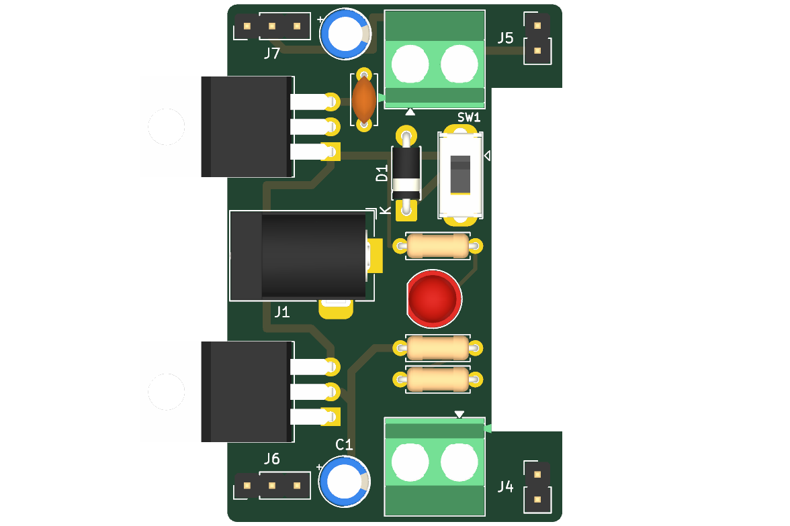
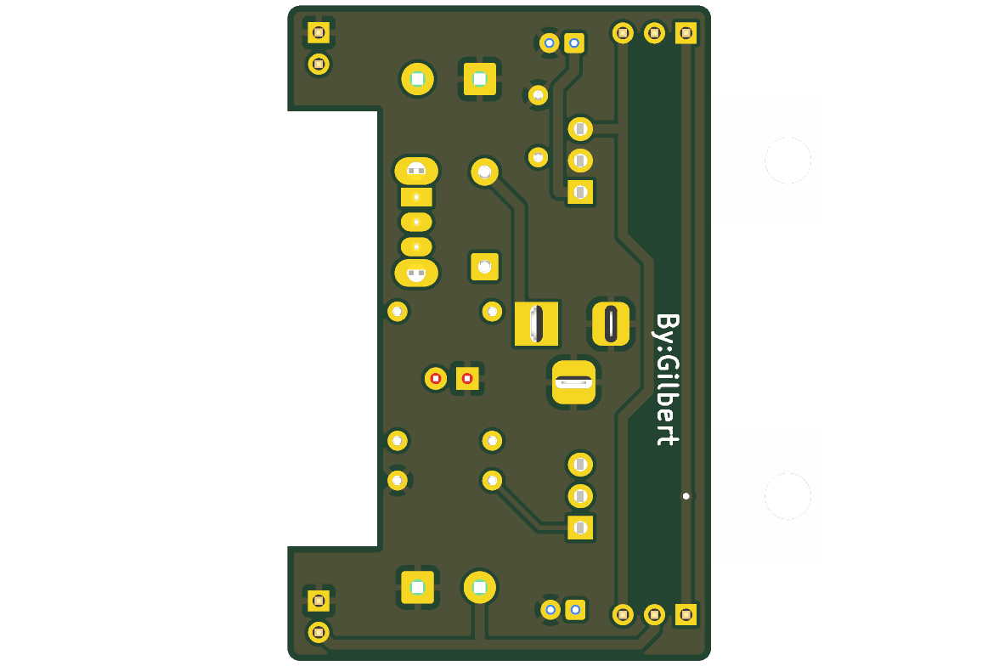
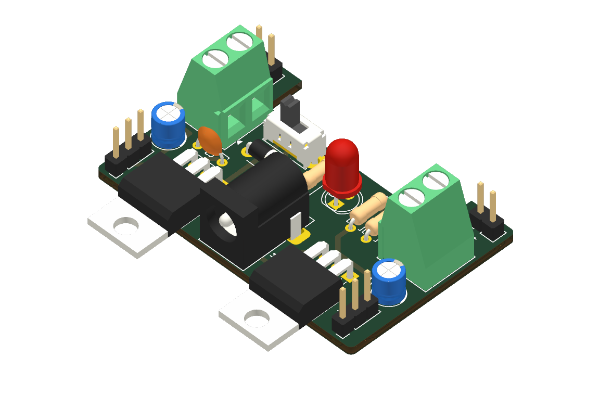

# Práctica #9: Diseño de una fuente de poder en KiCAD

**Fecha:** 25/10/2026
**Estudiante:** Gildardo Estevan Restrepo Duque
**Guía:** Diseño de una fuente de poder en KiCad — Prof. Fabio Guzmán, UPB

---

## Objetivo

Diseñar en KiCad un módulo de alimentación para protoboard: un adaptador DC entra por un jack, un LM7805 y un LM317 generan **5 V** y **3.3 V**, y dos selectores con jumper eligen qué tensión llega a cada riel de la protoboard y a su bornera. El diseño parte de una placa de referencia y le corrige cuatro errores de valores y protección.

## Archivos de esta práctica

- Especificación completa (requisitos, redes, cálculos, BOM): [`09_power_supply/especificacion.md`](../09_power_supply/especificacion.md)
- Proyecto KiCad: [`09_power_supply/power_supply_v1`](../09_power_supply/power_supply_v1)
- Esquemático en PDF: [`out/power_supply_v1.pdf`](../09_power_supply/power_supply_v1/out/power_supply_v1.pdf)

## Correcciones sobre la referencia

| Elemento | Referencia | Este diseño | Motivo |
|---|---|---|---|
| R1 (LED) | 330 Ω | **1 kΩ** | Con 12 V daba ≈ 29 mA y ≈ 0.28 W: excede el LED y una resistencia de 1/4 W |
| C1 (salida 3.3 V) | sin valor | **10 µF / 16 V** | El LM317 pide ≥ 1 µF a la salida |
| R2 / R3 (divisor LM317) | 330 / 560 Ω | **240 / 390 Ω** | 3.30 V en lugar de 3.40 V, y 5.2 mA de carga mínima en lugar de 3.8 mA |
| D1 (nuevo) | — | **1N5819** entre J1 y SW1 | Protección contra polaridad invertida |

## Cálculos principales

- **Salida de 3.3 V:** Vout = 1.25 × (1 + 390/240) + 50 µA × 390 ≈ **3.30 V**.
- **LED indicador:** 9.6 mA y 91 mW con 12 V; 6.6 mA y 43 mW con 9 V.
- **Entrada mínima:** el 7805 necesita ≥ 7 V y el 1N5819 quita ≈ 0.45 V → adaptador de **≥ 7.5 V** (recomendado 9 V).
- **Límite térmico** (TO-220 sin disipador, θJA ≈ 50 °C/W, 1.5 W por regulador):

| Entrada | I máx 5 V | I máx 3.3 V |
|---|---|---|
| 9 V | ≈ 420 mA | ≈ 285 mA |
| 12 V | ≈ 230 mA | ≈ 180 mA |

## Esquemático

18 componentes en dos bloques: entrada y 5 V (J1, D1, SW1, C3, U2 LM7805, C2) y 3.3 V (U1 LM317, R2, R3, C1, R1 y D2 como indicador), más los conectores de salida (J6/J7 selectores, J4/J5 al riel, J2/J3 borneras).

En la revisión se corrigieron dos errores de conexión antes del PCB:

- La etiqueta de la salida del 7805 decía `Vin`; pasó a `5V`, y `VIN` quedó en la entrada de los reguladores.
- Las etiquetas `3.3v` y `3.3V` formaban dos redes distintas (KiCad distingue mayúsculas), así que el jumper no recibía 3.3 V. Se unificaron.

**ERC:** 0 errores, 0 advertencias.

## PCB

- **Placa:** 2 capas, 34.06 × 52.70 mm, con una muesca en el lado derecho (7.2 mm de profundidad) para encajar sobre la protoboard. J5 y J4 quedan a 45.72 mm (18 pasos de 2.54 mm) para clavarse en los rieles.
- **Colocación:** los reguladores van acostados con la aleta fuera del borde izquierdo, como en la referencia (permite atornillar un disipador). El jack tiene la boca en el borde izquierdo. Las resistencias y el 1N5819 usan paso de 7.62 mm para caber en la columna central.
- **Clases de red:** Power (0.8 mm, separación 0.3 mm) para alimentación, salidas y GND; Default (0.4 mm) para el ajuste del LM317 y el LED.
- **Ruteo:** las redes de 3.3 V y 5 V bajan por B.Cu en líneas verticales que unen el selector de arriba (J7) con el de abajo (J6). La salida inferior va por B.Cu junto al borde. Una sola vía.
- **GND:** plano en B.Cu con alivios térmicos; el pad GND del 7805 tiene conexión sólida para disipar mejor.
- **Firma:** "By:Gilbert" en la serigrafía inferior.

**DRC con paridad esquemático/PCB:** 0 errores eléctricos y 0 conexiones pendientes. Quedan 4 avisos de serigrafía recortada por el borde, que corresponden a los reguladores que sobresalen a propósito.

## Evidencias

---
## Enlaces
[[diseno_electronico_iot|Diseño Electrónico IoT]]
